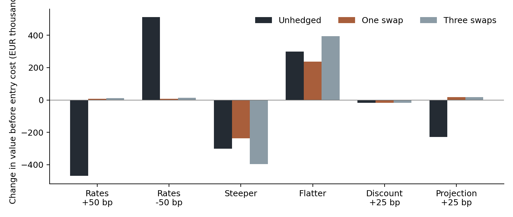

# Interest-rate curves and swap hedging

**George Dharma · Quant portfolio project 09 · Python 3.12**

How can additional swaps reduce the effect of changing interest rates on a portfolio? This project builds two EUR interest-rate curves, values four swaps and compares a single-swap hedge with a three-swap hedge.

**[Read the worked notebook](notebooks/analysis.ipynb)** · [Browse the Python code](rates/) · [Read the report](docs/report.pdf) · [Run it yourself](docs/RUNNING.md)

The notebook includes explanations, formulas, tables and saved charts. You can review it on GitHub without running the analysis.

## Main finding

A 10-year hedge removes the initial parallel rate sensitivity with about EUR 9.847 million of notional. It uses less notional and has a smaller worst loss in the chosen stress set than the three-swap hedge. The steepening scenario still loses about EUR 242,077 after the assumed entry cost.



**Scope:** ORE sample quotes dated 5 February 2016; hypothetical trades and shocks. Zero parallel sensitivity does not remove curve-shape risk. Starting present value is not trading profit.

## What the code demonstrates

Curve bootstrapping · cash-flow valuation · quote sensitivities · constrained least squares · scenario analysis · P&L reconciliation.

## Find your way around

| File or folder | Purpose |
| --- | --- |
| [`notebooks/analysis.ipynb`](notebooks/analysis.ipynb) | Start here: the complete worked example |
| [`rates/dates.py`](rates/dates.py) | Business days, day counts and payment schedules |
| [`rates/engine.py`](rates/engine.py) | Two curves, pricing and quote sensitivities |
| [`rates/analysis.py`](rates/analysis.py) | Portfolio, hedge sizes, stress cases and exports |
| [`run_analysis.py`](run_analysis.py) | Run the full calculation from one command |
| [`data/`](data/) | Fixed inputs and their source information |
| [`outputs/`](outputs/) | Saved tables and charts; regenerated by the code |
| [`tests/`](tests/) | 19 financial and numerical checks |
| [`docs/METHODOLOGY.md`](docs/METHODOLOGY.md) | Detailed assumptions, conventions, sources and limitations |

## Run the analysis

Download the complete repository using **Code → Download ZIP**, then extract it. Use Python 3.12 and open a terminal in the folder containing `run_analysis.py`.

On Windows PowerShell:

```powershell
py -3.12 -m venv .venv
.\.venv\Scripts\python.exe -m pip install -r requirements.txt
.\.venv\Scripts\python.exe run_analysis.py
.\.venv\Scripts\python.exe -m unittest discover -s tests -v
```

For macOS/Linux, JupyterLab and troubleshooting, see [the step-by-step instructions](docs/RUNNING.md). The analysis runs from bundled inputs without API keys. Rerunning overwrites generated outputs. [Validation notes](docs/VALIDATION.md) explain the checks performed.

## Sources and reuse

Source attribution and data provenance are retained in [the methodology](docs/METHODOLOGY.md) and `data/`. See [source and rights notes](NOTICE.md). This repository presents an independent portfolio research exercise; the referenced organisations do not endorse it.
